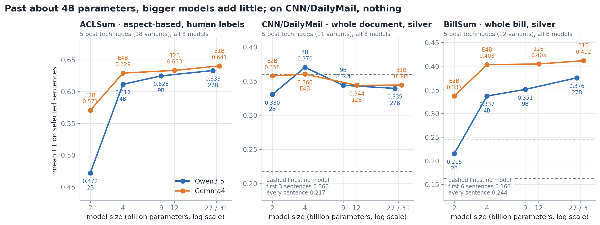
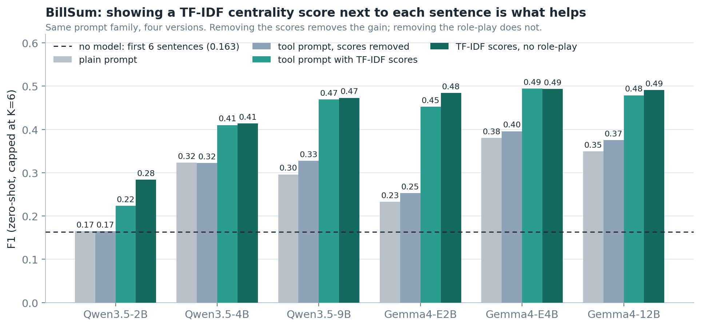
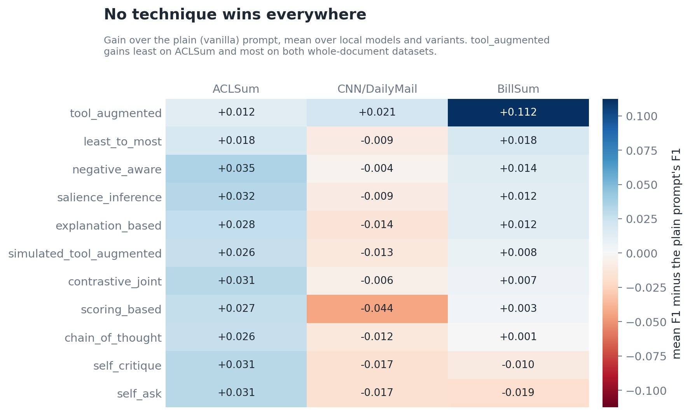
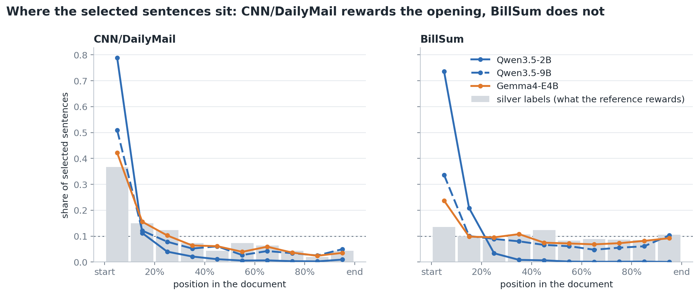
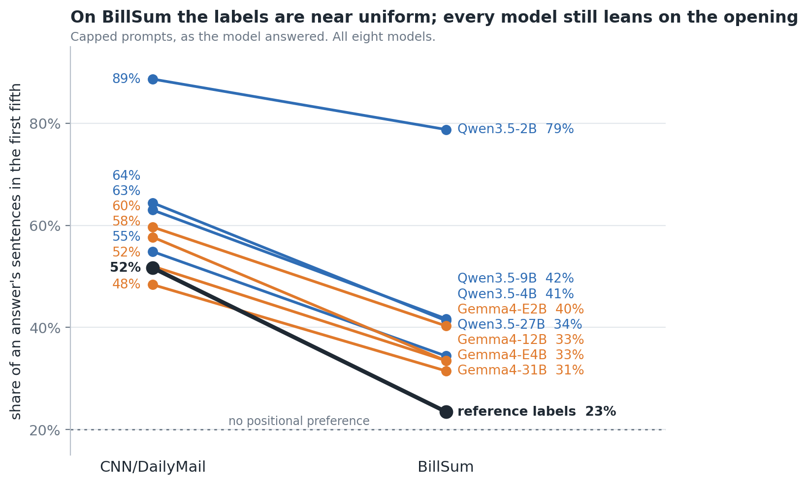
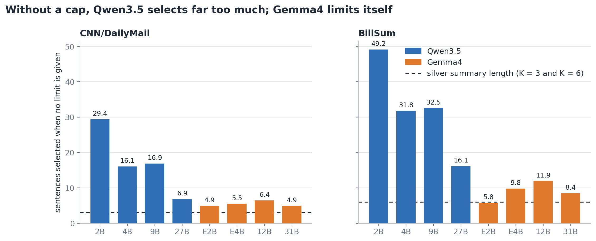
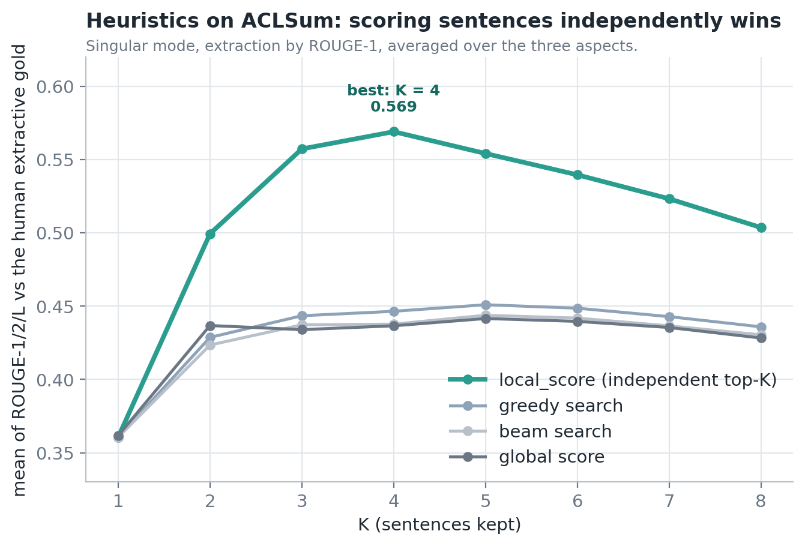

# Are LLMs good extractive summarizers?

A prompting study. We ask language models to summarize a document by **picking
sentences from it** (returning sentence numbers, not writing text), and measure
how well the picks match a reference selection. We vary three things:

- **the model**: two families at four matched sizes, Qwen3.5 (2B, 4B, 9B, 27B)
  and Gemma4 (E2B, E4B, 12B, 31B);
- **the prompting technique**: 12 techniques (plain, chain-of-thought,
  self-ask, scoring, TF-IDF "tool" prompts, ...) plus ablations;
- **the prompt variant**: zero-shot or one-shot, and with or without a cap on
  the number of sentences.

No model is trained or fine-tuned. Everything is inference with a fixed prompt.

The work has three parts:

| Part | Question | Dataset | Reference labels |
| --- | --- | --- | --- |
| **A** | Can LLMs pick the sentences for one *aspect* of a paper? | ACLSum (scientific papers; challenge / approach / outcome) | human |
| **B** | Which heuristic best turns an abstractive summary into extractive summary? | ACLSum | human, used to judge the heuristics |
| **C** | Does Part A carry over to whole documents, in other domains? | CNN/DailyMail (news), BillSum (US bills) | "silver": produced by Part B's heuristic |

All code is in [`extsum/`](extsum/README.md). Every number below comes from
`extsum/reports/`.

**Full analysis, one document per part:**

- [Part A — aspect-based selection on ACLSum](docs/analysis_part_a_aclsum.md)
- [Part B — heuristics for building extractive labels](docs/analysis_part_b_heuristics.md)
- [Part C — whole documents on silver labels](docs/analysis_part_c_whole_document.md)
- [Positional bias — in the labels, in the models, across datasets](docs/analysis_positional_bias.md)
- [The prompting techniques — what each one asks the model to do](docs/techniques.md)

The raw tables are in [`summary_result.md`](summary_result.md).

---

## The findings in five charts

### 1. Past about 4B parameters, bigger models add little; on CNN/DailyMail, nothing



- On **ACLSum** and **BillSum** the jump is from the smallest model to the
  next one (Qwen 2B → 4B: +0.14 and +0.12 F1). After that the curves flatten:
  the largest step at the top is Qwen 9B → 27B on BillSum, +0.025.
- **Gemma4 beats Qwen3.5 at every size** on ACLSum and BillSum. On BillSum,
  Gemma4-E4B (0.403) outscores Qwen3.5-27B (0.376).
- On **CNN/DailyMail** size makes no difference at all. All eight models are
  between 0.33 and 0.37, around the trivial "take the first 3 sentences"
  baseline (0.360), and Qwen3.5-27B is significantly *below* Qwen3.5-4B. That
  is a property of the dataset; see chart 4.

The three panels use different technique subsets (stated above each), so
compare shapes across panels, not heights.

### 2. On whole documents, a TF-IDF score beside each sentence beats every reasoning technique



The `tool_augmented` prompt prints a TF-IDF centrality score next to each
sentence. On BillSum it adds **0.06 to 0.25 F1** over the plain prompt for
every local model (all 12 paired comparisons significant). The ablations show
where the gain comes from: take the scores away and it disappears; take the
role-play framing away and nothing changes.

### 3. No technique wins everywhere



- On **ACLSum** every technique beats the plain prompt by a similar margin
  (+0.01 to +0.035), and `tool_augmented` gains the least.
- On **BillSum** it is the reverse: `tool_augmented` is the only technique
  with a clear gain, and the reasoning techniques are within about ±0.02 of
  the plain prompt.
- On **CNN/DailyMail** nothing beats the plain prompt reliably: the reasoning
  techniques are slightly below it, and `tool_augmented` is +0.02 above, which
  is not significant.

So the "best five techniques" differ by dataset, and no technique is in the
top five of all three.

### 4. CNN/DailyMail rewards position; BillSum does not



The grey bars show where the *reference* sentences sit. In CNN/DailyMail, 37%
of them are in the first tenth of the article, so copying the opening scores
well. In BillSum they are spread almost evenly. The lines show where models
pick when capped:

- **Qwen3.5-2B** takes the opening regardless of content: about three quarters
  of its picks are in the first tenth on both datasets. On CNN/DailyMail that
  habit is rewarded (capped F1 0.378, above the lead baseline and second best
  of the local models); on BillSum it scores at baseline level.
- **Gemma4-E4B** follows the reference distribution much more closely on both.

This is why BillSum was added: it separates selecting from copying positions.

| No-model baseline | CNN/DailyMail F1 (K = 3) | BillSum F1 (K = 6) |
| --- | :-: | :-: |
| First K sentences | 0.360 | 0.163 |
| Every sentence | 0.217 | 0.244 |



Measured per answer, the labels' share in the first fifth drops from 52% on
CNN/DailyMail to 23.5% on BillSum. The models follow about two thirds of the
way: on BillSum every one of them still picks 8 to 18 points more from the
opening than the labels do (55 for Qwen3.5-2B).

The same habit has opposite consequences on the two datasets:

| | CNN/DailyMail | BillSum |
| --- | :-: | :-: |
| Correlation between a model's lead bias and its F1 (8 models) | +0.70 | −0.95 |

On CNN/DailyMail the models that lean hardest on the opening score highest; on
BillSum they score lowest. Larger models lean on it less, which is why size
shows no benefit on CNN/DailyMail. The full analysis, including the labels of
every dataset and the effect of model size, is in
[`docs/analysis_positional_bias.md`](docs/analysis_positional_bias.md).

### 5. Without a cap, Qwen3.5 selects far too much



Asked to select "the important sentences" with no limit, Qwen3.5-2B returns
nearly the whole document (CNN/DailyMail articles average 31 sentences, bills
51). The habit eases with size: at 27B it is gone on news (7 sentences) and
reduced on bills (16). Gemma4 selects 5 to 12 sentences on its own. A cap
therefore helps the smaller Qwen models and makes little difference to Gemma.

---

## Part A — aspect-based selection on ACLSum

100 test papers, three aspects each, human gold labels. 54 prompt variants on
the six local models; the two endpoint-only large models ran the 5 best
techniques (18 variants).

| Model | F1 (all 54 variants) | F1 (5 best techniques) | ROUGE-L (variants run) |
| --- | :-: | :-: | :-: |
| Qwen3.5-2B | 0.461 | 0.472 | 0.137 |
| Qwen3.5-4B | 0.609 | 0.612 | 0.176 |
| Qwen3.5-9B | 0.623 | 0.625 | 0.177 |
| Qwen3.5-27B | n/a | 0.633 | 0.178 |
| Gemma4-E2B | 0.567 | 0.571 | 0.185 |
| Gemma4-E4B | 0.611 | 0.629 | 0.179 |
| Gemma4-12B | 0.631 | 0.633 | 0.179 |
| Gemma4-31B | n/a | 0.641 | 0.181 |

- **Scaling** is monotonic in both families and flat at the top: 9B → 27B and
  12B → 31B both gain 0.008.
- **Capping** barely changes F1 but clearly improves ROUGE-L (for example
  Qwen3.5-9B: 0.194 capped, 0.161 uncapped), because it stops over-selection.
- **One-shot** hurts the two smallest models (−0.037 each) and helps the
  larger ones (up to +0.037).
- **Reasoning traces** in the one-shot example help slightly (largest gain
  +0.029, Gemma4-E2B).
- **Best techniques:** `self_ask`, `negative_aware`, `salience_inference`,
  `self_critique`, `contrastive_joint`. The plain prompt is last (0.558).

## Part B — turning written summaries into sentence labels

Whole-document datasets come with a written summary, not with sentence labels.
Part B compares ways to derive labels from the summary, judged on ACLSum where
human sentence labels exist.



**`local_score` wins**: score each sentence on its own against the summary
(ROUGE) and keep the top K. Greedy, beam and global search penalize
redundancy, which costs recall (0.56 against 0.79 at the best setting). It is
also the cheapest by an order of magnitude. MMR over sentence embeddings and
MoverScore as the objective do not beat it either.

Part C uses `local_score` with ROUGE-1 to build its labels.

## Part C — whole documents on silver labels

100 random test documents per dataset (seed 42), the same for every model. 52
prompt variants on the six local models; the two large models ran each
dataset's five best techniques.

The number of sentences K is derived the same way for both datasets, from the
compression ratio on a split that is not evaluated: the reference summary's
share of the document's words, times the document's number of sentences,
median over documents.

| | CNN/DailyMail | BillSum |
| --- | :-: | :-: |
| Summary length as a share of the document | 9% | 13% |
| Sentences per document, median | 28 | 46 |
| **K** | **3** | **6** |

### CNN/DailyMail

| Model | F1, all 52 variants | F1, capped | F1, uncapped | F1, 11 shared variants |
| --- | :-: | :-: | :-: | :-: |
| Qwen3.5-2B | 0.302 | 0.378 | 0.227 | 0.330 |
| Qwen3.5-4B | 0.354 | 0.390 | 0.317 | 0.370 |
| Qwen3.5-9B | 0.331 | 0.363 | 0.299 | 0.344 |
| Qwen3.5-27B | n/a | n/a | n/a | 0.339 |
| Gemma4-E2B | 0.350 | 0.347 | 0.353 | 0.358 |
| Gemma4-E4B | 0.360 | 0.362 | 0.358 | 0.360 |
| Gemma4-12B | 0.344 | 0.341 | 0.348 | 0.344 |
| Gemma4-31B | n/a | n/a | n/a | 0.344 |

"First 3 sentences" scores 0.360.

- **No model clearly beats the lead baseline**, and no model is clearly better
  than another: Gemma4-31B equals 12B (p = 0.88), and Qwen3.5-27B is below
  4B (−0.031, p = 0.002).
- **No technique difference involving the TF-IDF prompts is significant** (0
  of 198 comparisons). The plain prompt ranks fifth of twenty techniques.
- **The models that pick most from the opening score highest.** The dataset
  does not discriminate between models or techniques; it is useful as a
  control for what a position-driven result looks like.

### BillSum

Bills are split with a structure-aware splitter (each numbered provision is a
unit).

| Model | F1, all 52 variants | F1, capped | F1, uncapped | Best variant |
| --- | :-: | :-: | :-: | :-: |
| Qwen3.5-2B | 0.211 | 0.179 | 0.242 | 0.284 |
| Qwen3.5-4B | 0.312 | 0.329 | 0.295 | 0.414 |
| Qwen3.5-9B | 0.316 | 0.333 | 0.300 | 0.473 |
| Gemma4-E2B | 0.288 | 0.294 | 0.282 | 0.484 |
| Gemma4-E4B | 0.387 | 0.391 | 0.383 | 0.495 |
| Gemma4-12B | 0.389 | 0.387 | 0.391 | 0.491 |

The best variant for every model is a TF-IDF tool prompt, zero-shot, capped.

**Large tier** (same 12 variants for all eight models):

| Model | F1 | ROUGE-L |
| --- | :-: | :-: |
| Qwen3.5-9B | 0.351 | 0.278 |
| Qwen3.5-27B | 0.376 | 0.294 |
| Gemma4-12B | 0.405 | 0.295 |
| Gemma4-31B | 0.412 | 0.310 |

- Qwen 9B → 27B: +0.025, significant (paired Wilcoxon, p = 0.004).
- Gemma 12B → 31B: +0.007, not significant (p = 0.36).
- Gemma4-31B is *worse* than 12B on the two TF-IDF variants (−0.036,
  p = 0.005) and slightly better on the reasoning ones: larger models rely
  less on the scores.
- Reasoning traces do not help on BillSum; five of six models are slightly
  worse with them.

---

## Repository

```
README.md             this file
docs/                 the analysis, one document per part
summary_result.md     every table, all three parts
extsum/               the code, configs, cached traces, reports and figures
  README.md           how it is organised and how to run it
  reports/            summary.csv, tables/ and figures/ per experiment
  reports/figures/    the charts above
```

### Reproduce

```bash
cd extsum
python -m venv .venv && . .venv/bin/activate
pip install -e ".[dev,endpoint]"
pytest -q                       # 56 tests, no GPU or network needed

extsum list                     # the four experiments
extsum report -e billsum cnndm  # rebuild summaries from raw answers
extsum analyze -e billsum       # significance, bootstrap, position bias
extsum figures                  # redraw the charts in this README
```

Running models needs a GPU (local tiers) or an OpenRouter key (large tier);
see [`extsum/README.md`](extsum/README.md) for the rented-GPU walkthrough.

### Setup details

- **Metrics:** precision, recall and F1 on selected sentence indices; ROUGE-L
  of the reconstructed summary against the written reference; the gap to a
  greedy ROUGE-L oracle.
- **Models:** local tiers at bf16 on vLLM (one A100 40GB) or Transformers; the
  27B and 31B through OpenRouter. Temperature 0, 512 output tokens.
- **One-shot exemplars** never come from evaluated documents. Reasoning traces
  are written once by a reference model (Qwen3.5-397B) and reused for every
  model.
- **Caps:** ACLSum uses the median gold count per aspect; Part C uses the K
  derived from each dataset's compression ratio (3 for CNN/DailyMail, 6 for
  BillSum).
