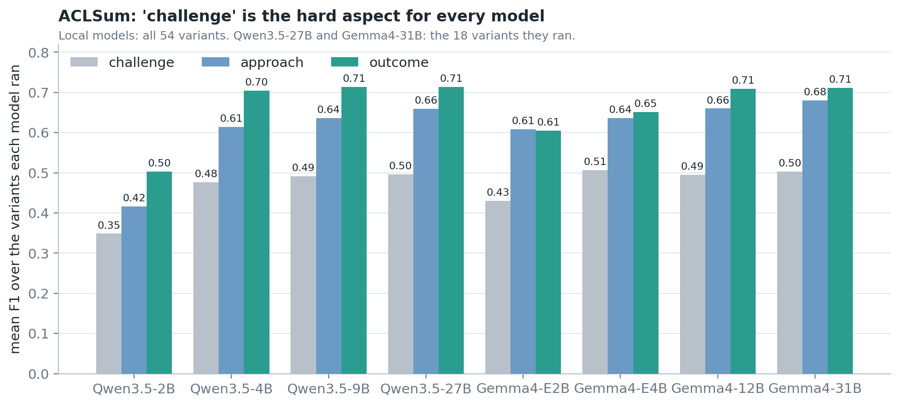

# Part A — Aspect-based extractive summarization on ACLSum

**Question.** Given a scientific paper split into sentences, can an LLM pick the
sentences that express one aspect of it (the _challenge_, the _approach_, or
the _outcome_), using only a prompt?

## Setup

|              |                                                                                                                                 |
| ------------ | ------------------------------------------------------------------------------------------------------------------------------- |
| Data         | ACLSum test split, 100 papers, human sentence labels for three aspects                                                          |
| Unit of work | one selection per (paper, aspect); a per-paper `union` row is derived from the three                                            |
| Models       | Qwen3.5 2B / 4B / 9B / 27B and Gemma4 E2B / E4B / 12B / 31B                                                                     |
| Grid         | 16 techniques × zero/one-shot × capped/uncapped = 54 variants (local models); 5 best techniques = 18 variants (27B, 31B)        |
| Cap          | per aspect, the median number of gold sentences on the validation split                                                         |
| Exemplars    | from the validation split, never from evaluated papers                                                                          |
| Metrics      | P / R / F1 on sentence indices; ROUGE-L of the selected text against the written aspect summary; gap to a greedy ROUGE-L oracle |

Means below include the `union` row, as in the published summary. Source:
`extsum/reports/aclsum/summary.csv`.

## 1. Model size: a step, then a plateau

| Model       | F1, all 54 variants | F1, 5 best techniques | Precision | Recall | ROUGE-L | Oracle gap |
| ----------- | :-----------------: | :-------------------: | :-------: | :----: | :-----: | :--------: |
| Qwen3.5-2B  |        0.461        |         0.472         |   0.438   | 0.674  |  0.137  |   0.263    |
| Qwen3.5-4B  |        0.609        |         0.612         |   0.626   | 0.661  |  0.176  |   0.225    |
| Qwen3.5-9B  |        0.623        |         0.625         |   0.641   | 0.678  |  0.177  |   0.223    |
| Qwen3.5-27B |         n/a         |         0.633         |   0.645   | 0.688  |  0.178  |   0.222    |
| Gemma4-E2B  |        0.567        |         0.571         |   0.626   | 0.570  |  0.185  |   0.216    |
| Gemma4-E4B  |        0.611        |         0.629         |   0.647   | 0.639  |  0.179  |   0.222    |
| Gemma4-12B  |        0.631        |         0.633         |   0.642   | 0.681  |  0.179  |   0.222    |
| Gemma4-31B  |         n/a         |         0.641         |   0.655   | 0.684  |  0.181  |   0.220    |

Precision, recall, ROUGE-L and oracle gap are over the variants each model ran.

- **The gain is concentrated at the bottom.** On the like-for-like column,
  Qwen 2B → 4B is +0.140 F1 and Gemma E2B → E4B is +0.058. Beyond 4B every
  step is at most +0.013, and the last ones (9B → 27B, 12B → 31B) are +0.008
  each.
- **Gemma4 leads Qwen3.5 at every tier**, by 0.10 at the smallest size and
  under 0.02 from 4B upwards.
- **What the smallest Qwen gets wrong is precision, not recall.** Qwen3.5-2B
  has the same recall as the larger models (0.674) but precision 0.438: it
  selects too much. Gemma4-E2B fails the other way, with good precision
  (0.626) and low recall (0.570).
- **ROUGE-L barely moves** (0.176–0.185 for every model except Qwen3.5-2B),
  and the gap to the oracle stays at 0.22. Better index F1 at larger sizes does
  not translate into text that is measurably closer to the written summary.

## 2. The aspect matters more than the technique

| Model       | challenge | approach | outcome | union |
| ----------- | :-------: | :------: | :-----: | :---: |
| Qwen3.5-2B  |   0.349   |  0.416   |  0.503  | 0.577 |
| Qwen3.5-4B  |   0.477   |  0.614   |  0.704  | 0.641 |
| Qwen3.5-9B  |   0.492   |  0.636   |  0.714  | 0.652 |
| Qwen3.5-27B |   0.496   |  0.660   |  0.714  | 0.663 |
| Gemma4-E2B  |   0.430   |  0.608   |  0.605  | 0.625 |
| Gemma4-E4B  |   0.506   |  0.636   |  0.652  | 0.650 |
| Gemma4-12B  |   0.495   |  0.660   |  0.709  | 0.658 |
| Gemma4-31B  |   0.503   |  0.681   |  0.711  | 0.667 |

- **_Challenge_ is the hard aspect for every model**, about 0.20 F1 below
  _outcome_. It also does not improve with size: it is 0.48–0.51 from 4B to
  31B. Both precision and recall are low for it (about 0.52 and 0.55), so the
  models neither find the gold sentences reliably nor avoid the others.
- **_Approach_ is the aspect that keeps improving with size** (Qwen 0.614 →
  0.660, Gemma 0.636 → 0.681). Most of the small gain at the top of the size
  range comes from here.
- **_Outcome_ saturates early** at about 0.71 for both families.
- The spread between aspects (about 0.20) is roughly ten times the spread
  between techniques for a mid-sized model (about 0.02; next section).

## 3. Prompting technique: small effects, and only for small models

Mean over the six local models and all variants of each technique:

| Rank | Technique                |  F1   | Precision | Recall | ROUGE-L |
| :--: | ------------------------ | :---: | :-------: | :----: | :-----: |
|  1   | self_ask_trace           | 0.596 |   0.622   | 0.657  |  0.176  |
|  2   | negative_aware           | 0.593 |   0.626   | 0.639  |  0.178  |
|  3   | salience_inference_trace | 0.591 |   0.636   | 0.625  |  0.181  |
|  4   | salience_inference       | 0.591 |   0.631   | 0.629  |  0.180  |
|  5   | self_critique            | 0.590 |   0.601   | 0.662  |  0.171  |
|  6   | self_ask                 | 0.590 |   0.599   | 0.671  |  0.171  |
|  7   | contrastive_joint        | 0.589 |   0.613   | 0.657  |  0.175  |
|  8   | explanation_based        | 0.586 |   0.601   | 0.656  |  0.171  |
|  9   | chain_of_thought_trace   | 0.586 |   0.596   | 0.672  |  0.171  |
|  10  | scoring_based_trace      | 0.586 |   0.609   | 0.652  |  0.174  |
|  11  | scoring_based            | 0.585 |   0.600   | 0.662  |  0.171  |
|  12  | chain_of_thought         | 0.584 |   0.598   | 0.664  |  0.171  |
|  13  | simulated_tool_augmented | 0.584 |   0.603   | 0.656  |  0.173  |
|  14  | least_to_most            | 0.576 |   0.587   | 0.652  |  0.168  |
|  15  | tool_augmented           | 0.571 |   0.594   | 0.621  |  0.168  |
|  16  | vanilla                  | 0.558 |   0.573   | 0.628  |  0.164  |

- **Thirteen of sixteen techniques are within 0.012 F1 of each other**
  (0.584–0.596). The ranking among them should not be read as an ordering.
- **What is clear is the bottom**: the plain prompt is last, and the two
  prompts that hand the model extra structure (`tool_augmented`,
  `least_to_most`) are just above it. Any explicit instruction on _how_ to
  judge a sentence helps a little over giving none.
- **The technique only matters for weaker models.** The spread between the
  best and worst technique is 0.087 for Qwen3.5-2B, 0.060 for Gemma4-E2B and
  0.146 for Gemma4-E4B, against 0.017 for Qwen3.5-9B and 0.018 for Gemma4-12B.
  Gemma4-E4B's large spread comes from two prompts it handles badly, `vanilla`
  (0.495) and `least_to_most` (0.539); on the others it scores 0.59–0.64.
- **The five techniques sent to the large tier** are the top five base
  techniques once `_trace` variants are folded into their base: `self_ask`,
  `negative_aware`, `salience_inference`, `self_critique`,
  `contrastive_joint`.

## 4. Capping: no effect on F1, a clear effect on the summary

| Model       | F1 capped | F1 uncapped | ROUGE-L capped | ROUGE-L uncapped |
| ----------- | :-------: | :---------: | :------------: | :--------------: |
| Qwen3.5-2B  |   0.486   |    0.437    |     0.178      |      0.097       |
| Qwen3.5-4B  |   0.602   |    0.616    |     0.191      |      0.160       |
| Qwen3.5-9B  |   0.620   |    0.627    |     0.194      |      0.161       |
| Qwen3.5-27B |   0.628   |    0.639    |     0.192      |      0.164       |
| Gemma4-E2B  |   0.558   |    0.576    |     0.192      |      0.177       |
| Gemma4-E4B  |   0.603   |    0.619    |     0.187      |      0.170       |
| Gemma4-12B  |   0.623   |    0.638    |     0.192      |      0.166       |
| Gemma4-31B  |   0.631   |    0.650    |     0.193      |      0.169       |

- **F1 is slightly higher uncapped** for every model except Qwen3.5-2B, by
  0.01–0.02. The cap removes some correct sentences along with the wrong ones.
- **ROUGE-L is higher capped for every model**, by 0.02–0.03 (0.08 for
  Qwen3.5-2B). An uncapped selection is longer, and ROUGE-L against a short
  written summary punishes length.
- The two metrics therefore disagree about the cap. Index F1 rewards finding
  the gold sentences; ROUGE-L rewards a selection that reads like the summary.
  Which to prefer depends on the use: capped output is the better _summary_.
- Qwen3.5-2B is the one model the cap rescues on both metrics, because uncapped
  it over-selects badly (recall 0.861 at low precision).

## 5. One-shot: hurts the smallest models, helps the rest

| Model       | zero-shot | one-shot |   Δ    |
| ----------- | :-------: | :------: | :----: |
| Qwen3.5-2B  |   0.483   |  0.446   | −0.037 |
| Qwen3.5-4B  |   0.605   |  0.612   | +0.007 |
| Qwen3.5-9B  |   0.615   |  0.629   | +0.014 |
| Qwen3.5-27B |   0.630   |  0.636   | +0.006 |
| Gemma4-E2B  |   0.589   |  0.552   | −0.037 |
| Gemma4-E4B  |   0.589   |  0.626   | +0.037 |
| Gemma4-12B  |   0.625   |  0.635   | +0.010 |
| Gemma4-31B  |   0.630   |  0.649   | +0.019 |

A worked example costs both 2B-class models 0.037 F1 and helps every larger
model. The likely reading is that a small model is distracted by a second
document in the prompt, while a larger one can use it; the data here cannot
separate that from the longer prompt simply being harder.

## 6. Showing the reasoning in the example

For four reasoning techniques, a second one-shot variant shows a reasoning
trace written by a reference model (Qwen3.5-397B) instead of only the answer.

| Model      | answer-only example | example with trace |   Δ    |
| ---------- | :-----------------: | :----------------: | :----: |
| Qwen3.5-2B |        0.450        |       0.450        | 0.000  |
| Qwen3.5-4B |        0.608        |       0.617        | +0.008 |
| Qwen3.5-9B |        0.629        |       0.630        | +0.001 |
| Gemma4-E2B |        0.542        |       0.571        | +0.029 |
| Gemma4-E4B |        0.630        |       0.638        | +0.008 |
| Gemma4-12B |        0.635        |       0.632        | −0.004 |

The trace helps Gemma4-E2B by 0.029 and is within 0.01 of no effect for
everyone else. It is not a general improvement.

### How the traces were produced

A one-shot example normally shows a document and its answer. For the four
reasoning techniques (`chain_of_thought`, `self_ask`, `scoring_based`,
`salience_inference`) a second variant, named `<technique>_trace`, also shows
the reasoning that leads to the answer. That reasoning is not hand-written:

1. **A reference model writes it.** Qwen3.5-397B, a model far larger than any
   in the grid, is given an example paper and asked to solve it for one aspect
   _and show its working_ in the style of the technique (step-by-step
   reasoning, question and answer per sentence, a score per sentence, or a
   salient theme plus scores), ending with its selected sentence numbers.
2. **Its answer is checked against the human labels.** The F1 between the
   sentences it selected and the gold sentences of that example is computed.
3. **The best-agreeing attempt is kept.** Up to 10 example papers are tried
   per technique and aspect. The first one reaching F1 ≥ 0.7 is accepted;
   otherwise the best one is kept if it reaches 0.4; below that no trace is
   stored and the variant falls back to an answer-only example.
4. **It is frozen and reused.** The example paper, the trace and the answer
   are saved once (`extsum/data/rationales/aclsum/`) and shown identically to
   every model in the grid.

The point of the design is that every model sees the _same_ demonstration of
how to reason, so a difference between the plain and `_trace` variants is the
effect of showing the reasoning, not of each model reasoning for itself.

The 12 traces (4 techniques × 3 aspects) and how well the reference model's
answer agreed with the human labels:

| Technique          | challenge | approach | outcome |
| ------------------ | :-------: | :------: | :-----: |
| chain_of_thought   |   0.86    |   0.90   |  0.75   |
| self_ask           |   0.67    |   0.95   |  0.80   |
| scoring_based      |   0.75    |   0.95   |  1.00   |
| salience_inference |   0.92    |   0.90   |  0.80   |

Traces are 250 to 560 words long. Eleven of the twelve cleared the 0.7
threshold; `self_ask` on _challenge_ was kept at 0.67 as the best of its ten
attempts.

Three things to keep in mind when reading the comparison above:

- **The example shows the reference model's own answer, not the human
  labels.** Where the two differ (F1 below 1), the model is shown a slightly
  imperfect answer, so that the reasoning and the answer agree with each other.
- **The two variants do not use the same example paper.** The answer-only
  example is drawn from the validation split with its gold answer; the trace
  example is whichever train paper the reference model solved best. The
  comparison therefore mixes "reasoning shown" with "different example".
- **A trace makes the prompt longer** by a few hundred words, which may itself
  affect small models.

## 7. Best single variant per model

| Model       | Best F1 | Technique                | Shot |   Cap    |
| ----------- | :-----: | ------------------------ | :--: | :------: |
| Qwen3.5-2B  |  0.561  | explanation_based        | zero |  capped  |
| Qwen3.5-4B  |  0.630  | salience_inference_trace | one  | uncapped |
| Qwen3.5-9B  |  0.640  | salience_inference_trace | one  | uncapped |
| Qwen3.5-27B |  0.658  | salience_inference       | one  | uncapped |
| Gemma4-E2B  |  0.619  | contrastive_joint        | zero | uncapped |
| Gemma4-E4B  |  0.651  | scoring_based_trace      | one  | uncapped |
| Gemma4-12B  |  0.650  | salience_inference       | one  | uncapped |
| Gemma4-31B  |  0.666  | salience_inference       | one  | uncapped |

The pattern matches the sections above: the two smallest models do best
zero-shot, everything larger does best one-shot and uncapped, and
`salience_inference` is the best technique for five of the eight models. The
best variant is 0.02–0.05 above a model's average, except for Qwen3.5-2B
(+0.10), where the choice of prompt matters most.

## Conclusions

1. **Size has a threshold, not a slope.** A 4B model reaches 0.61 F1; a 31B
   model reaches 0.64. For this task a mid-sized model is close to the ceiling
   that prompting alone reaches.
2. **The aspect is the largest source of variation.** _Challenge_ sits 0.20
   below _outcome_ for every model and does not improve with size, which
   points to the aspect's definition or labels rather than to model capacity.
3. **Prompting technique is a second-order effect** for any model of 9B or
   more (under 0.02 F1), and thirteen techniques are indistinguishable.
4. **Capping is a choice of metric.** It costs about 0.015 F1 and gains about
   0.025 ROUGE-L.
5. **Exemplars need capacity.** They hurt 2B-class models and help larger
   ones.
