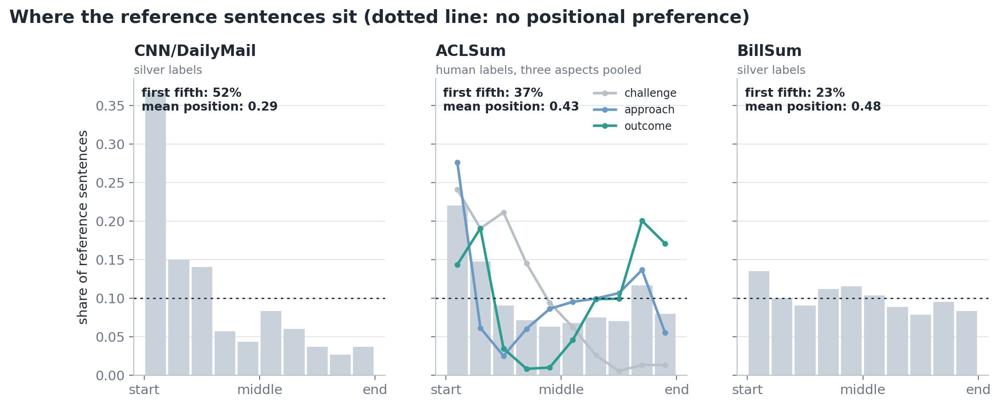
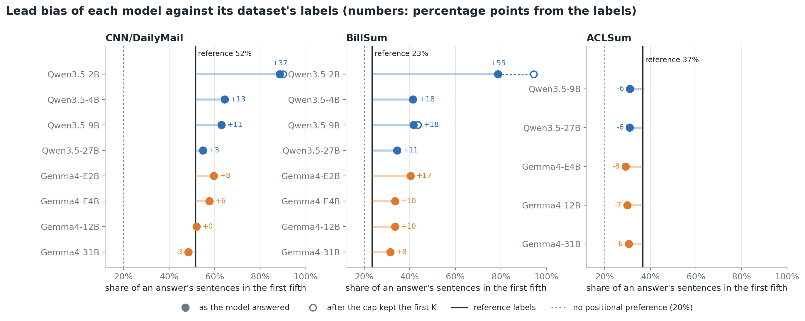

# Positional bias: in the labels, in the models, and across datasets

**Question.** Extractive summarization can be "solved" by position: take the
opening sentences. How much of what we measure is position? This document
separates three things that are easy to confuse:

1. the positional bias of the **reference labels** (human gold on ACLSum,
   `local_score` silver labels elsewhere): what the dataset _rewards_;
2. the positional bias of the **models**: where they actually pick;
3. the gap between the two: bias the model brings that the dataset does not
   ask for.

**Short answer.**

- The silver labels of **CNN/DailyMail are strongly lead-biased** (52% of
  them in the first fifth of the article). Those of **BillSum are close to
  uniform** (23.5%; no preference would be 20%). BillSum suffers far less from
  positional bias, as intended.
- **Every model prefers the opening**, on both datasets. On CNN/DailyMail that
  matches the labels and is rewarded: the models that lean hardest on the
  opening score highest. On BillSum it does not match, and the models that
  lean on it most score lowest.
- **Models adapt to the document, but not all the way.** From news to bills
  the labels' lead share falls by 28 points; the models' falls by 17 to 24.
  On BillSum every model stays 8 to 18 points above the labels.
- **Size and family matter.** Qwen3.5-2B selects almost purely by position.
  From 4B up the bias is moderate, falls with size, and is lower for Gemma4
  than for Qwen3.5.
- Human labels are positional too: on ACLSum, _challenge_ sentences sit at
  the start of a paper and _outcome_ sentences at the end.

## How it is measured

Each document is divided into ten equal parts by sentence position. For a set
of selected sentences we record the share falling in each part.

| Measure                      | Meaning                                                                  | Value with no positional preference |
| ---------------------------- | ------------------------------------------------------------------------ | :---------------------------------: |
| **Lead share**               | share of the selected sentences in the first fifth of the document       |                 20%                 |
| **Mean position**            | average position of a selected sentence, 0 = start, 1 = end              |                0.50                 |
| **Distance from uniform**    | total-variation distance between the position histogram and a flat one   |                  0                  |
| **Distance from the labels** | the same distance, between a model's histogram and the reference labels' |                  0                  |

Shares are computed **per answer and then averaged**, so a model that returns
forty sentences for one document does not outweigh forty normal answers.

For models, the capped prompts are used (the model is told to select at most K
sentences), and each answer is measured twice:

- **as answered**: what the model wrote;
- **after the cap**: what was scored, after the runner kept only the first K
  sentences in document order. The difference is bias added by truncation,
  not by the model.

K is 3 on CNN/DailyMail and 6 on BillSum, each derived from the dataset's own
compression ratio.

## 1. The labels: how much position each dataset rewards

| Dataset         | Labels                       | Sentences per document | Lead share | Mean position | Distance from uniform | F1 of "first K sentences" |
| --------------- | ---------------------------- | :--------------------: | :--------: | :-----------: | :-------------------: | :-----------------------: |
| CNN/DailyMail   | silver, `local_score`, K = 3 |          30.8          | **51.7%**  |     0.29      |         0.357         |           0.360           |
| ACLSum (pooled) | human                        |          37.7          |   36.7%    |     0.43      |         0.184         |            n/a            |
| **BillSum**     | silver, `local_score`, K = 6 |          50.9          | **23.5%**  |     0.48      |         0.065         |           0.163           |

- **CNN/DailyMail is the positional dataset.** 37% of its silver sentences
  are in the first tenth of the article and 52% in the first fifth. Its
  histogram is more than five times further from uniform than BillSum's.
- **BillSum is nearly flat.** Its lead share is 3.5 points above no
  preference, and no tenth of the bill holds more than 13.5% of the labels.
- **The same heuristic produced both.** `local_score` has no notion of
  position: it ranks sentences by word overlap with the written summary. The
  lead bias in CNN/DailyMail's labels comes from the _data_ (news puts the
  key facts first, and the reference highlights restate them), not from the
  labelling rule. On bills, whose summaries draw on provisions spread through
  the text, the same rule gives spread-out labels.
- **The practical consequence is the baseline.** Returning the first K
  sentences scores 0.360 F1 on CNN/DailyMail and 0.163 on BillSum. On
  CNN/DailyMail that is level with every model; on BillSum it is below every
  model.

**ACLSum: human labels are positional too, by aspect.**

| Aspect    | Lead share | Share in the last fifth | Mean position |
| --------- | :--------: | :---------------------: | :-----------: |
| challenge |   43.1%    |          2.6%           |     0.27      |
| approach  |   33.7%    |          19.1%          |     0.46      |
| outcome   |   33.4%    |          37.1%          |     0.56      |

_Challenge_ sentences are at the start of a paper (abstract and
introduction) and almost never at the end. _Outcome_ sentences are at both
ends: the abstract and the conclusion. Pooled, the three give a moderate lead
share, but each aspect on its own is more positional than BillSum.

## 2. The models: where they pick

Lead share of each model's answers under capped prompts, as answered, and the
difference from the labels in percentage points:

| Model       | CNN/DailyMail (labels 51.7%) | BillSum (labels 23.5%) | ACLSum (labels 36.7%) |
| ----------- | :--------------------------: | :--------------------: | :-------------------: |
| Qwen3.5-2B  |         88.6% (+37)          |      78.8% (+55)       |          n/a          |
| Qwen3.5-4B  |         64.4% (+13)          |      41.3% (+18)       |          n/a          |
| Qwen3.5-9B  |         63.0% (+11)          |      41.7% (+18)       |      31.1% (−6)       |
| Qwen3.5-27B |          54.9% (+3)          |      34.4% (+11)       |      30.9% (−6)       |
| Gemma4-E2B  |          59.7% (+8)          |      40.3% (+17)       |          n/a          |
| Gemma4-E4B  |          57.7% (+6)          |      33.5% (+10)       |      29.1% (−8)       |
| Gemma4-12B  |          52.0% (0)           |      33.5% (+10)       |      29.9% (−7)       |
| Gemma4-31B  |          48.4% (−3)          |       31.5% (+8)       |      30.5% (−6)       |

"n/a": the model's raw ACLSum answers are not available.

### On CNN/DailyMail the larger models look unbiased, because the labels share the bias

From 27B and 12B upwards the models are within 3 points of the labels, and
Gemma4-31B is slightly _below_ them. Their position histograms are close to
the labels' (distance 0.08–0.12, apart from Qwen3.5-2B to 9B). Measured
against this dataset alone, one would conclude that the larger models have no
positional problem, and that the smaller ones have a mild one.

### On BillSum the same models are clearly lead-biased

Every model is above the labels, by 8 to 18 points from 4B upwards and by 55
for Qwen3.5-2B. Gemma4-31B, which sits 3 points _under_ the labels on
CNN/DailyMail, is 8 points _over_ them here. BillSum exposes a preference that
CNN/DailyMail hides.

### On ACLSum the models are slightly _below_ the human labels

All five models with raw answers pick 6–8 points less from the opening than
the annotators did. The per-aspect view shows why:

| Aspect    | Human labels: lead share | Models: lead share | Human labels: last fifth | Models: last fifth |
| --------- | :----------------------: | :----------------: | :----------------------: | :----------------: |
| challenge |          43.1%           |       24.7%        |           2.6%           |        6.7%        |
| approach  |          33.7%           |       33.5%        |          19.1%           |       13.1%        |
| outcome   |          33.4%           |       32.3%        |          37.1%           |       37.8%        |

Models match the human distribution closely for _approach_ and _outcome_,
including the concentration of _outcome_ at the end of the paper. For
_challenge_ they do not: annotators took 43% of challenge sentences from the
first fifth, models 25%. This is the aspect on which every model scores about
0.20 F1 lower (Part A). Models look for challenge statements throughout the
paper; annotators found them in the introduction.

So lead bias is not a fixed property of a model. Here the models are _under_
the reference, on the one aspect where position carries real information.

## 3. Across datasets: the labels change, the models follow part of the way

|                      | CNN/DailyMail | BillSum |  Change   |
| -------------------- | :-----------: | :-----: | :-------: |
| **Reference labels** |     51.7%     |  23.5%  | **−28.2** |
| Gemma4-E4B           |     57.7%     |  33.5%  |   −24.2   |
| Qwen3.5-4B           |     64.4%     |  41.3%  |   −23.1   |
| Qwen3.5-9B           |     63.0%     |  41.7%  |   −21.3   |
| Qwen3.5-27B          |     54.9%     |  34.4%  |   −20.5   |
| Gemma4-E2B           |     59.7%     |  40.3%  |   −19.4   |
| Gemma4-12B           |     52.0%     |  33.5%  |   −18.5   |
| Gemma4-31B           |     48.4%     |  31.5%  |   −16.9   |
| Qwen3.5-2B           |     88.6%     |  78.8%  |   −9.8    |

- **Models do respond to the document.** Every model picks less from the
  opening on bills than on news, so none is selecting by position alone, apart
  from Qwen3.5-2B, which barely moves.
- **They follow the labels about two thirds of the way.** The labels drop 28
  points; seven of the eight models drop 17 to 24. What remains on BillSum, a
  lead share of 31–42% against 23.5% in the labels, is the part of their
  behaviour that looks like a prior about where summaries come from.
- The two datasets use different K (3 and 6 sentences per answer), so the
  comparison is of shares, not of counts.

## 4. By model size and family

Points of lead share above the labels:

| Size tier | CNN/DailyMail: Qwen3.5 | CNN/DailyMail: Gemma4 | BillSum: Qwen3.5 | BillSum: Gemma4 |
| --------- | :--------------------: | :-------------------: | :--------------: | :-------------: |
| 2B        |          +37           |          +8           |       +55        |       +17       |
| 4B        |          +13           |          +6           |       +18        |       +10       |
| 9B / 12B  |          +11           |           0           |       +18        |       +10       |
| 27B / 31B |           +3           |          −3           |       +11        |       +8        |

- **The bias falls with size, in both families and on both datasets.**
- **Gemma4 is less lead-biased than Qwen3.5 at every tier**, on both datasets.
- **The large drop is from 2B to 4B** for Qwen3.5; after that the decline is
  gradual.
- **On BillSum even the best model keeps a lead bias of 8 points.**

## 5. Qwen3.5-2B: selection by position

|                                                                     | CNN/DailyMail | BillSum |
| ------------------------------------------------------------------- | :-----------: | :-----: |
| Capped answers that are a run starting at sentence 1 (1, 2, 3, ...) |      57%      |   74%   |
| Capped answers longer than K, cut by the runner                     |      2%       |   22%   |
| Mean sentences per capped answer, as answered                       |      3.7      |  14.6   |
| Lead share, as answered                                             |      89%      |   79%   |
| Lead share, after the cap                                           |      90%      |   94%   |

In well over half of its capped answers this model returns the first
sentences of the document in order. On BillSum it also ignores the limit in
one answer of five and lists far more, and the runner then keeps the first K,
which pushes the lead share up further (the open circle in the chart). For no
other model does truncation change the lead share by more than 2 points: from
4B up, at most 3% of capped answers exceed K.

On CNN/DailyMail this earns it the second-best capped score of the six local
models (0.378, above the lead baseline of 0.360). On BillSum it is the worst
(0.179, at the baseline of 0.163). The model did not change; the dataset did.

## 6. Does the prompt change the bias?

Lead share under four versions of the zero-shot capped prompt:

**CNN/DailyMail** (labels 51.7%)

| Model       | plain | tool, scores removed | tool with TF-IDF | TF-IDF, no role-play |
| ----------- | :---: | :------------------: | :--------------: | :------------------: |
| Qwen3.5-2B  | 87.0% |        88.0%         |      69.7%       |        62.0%         |
| Qwen3.5-4B  | 69.0% |        62.7%         |      47.7%       |        47.0%         |
| Qwen3.5-9B  | 64.0% |        64.7%         |      38.7%       |        37.0%         |
| Qwen3.5-27B | 59.3% |        58.3%         |      48.7%       |        45.3%         |
| Gemma4-E2B  | 61.0% |        59.6%         |      54.3%       |        52.4%         |
| Gemma4-E4B  | 54.0% |        54.7%         |      37.7%       |        40.7%         |
| Gemma4-12B  | 47.9% |        48.2%         |      42.8%       |        42.5%         |
| Gemma4-31B  | 50.2% |        47.5%         |      42.5%       |        41.5%         |

**BillSum** (labels 23.5%)

| Model      | plain | tool, scores removed | tool with TF-IDF | TF-IDF, no role-play |
| ---------- | :---: | :------------------: | :--------------: | :------------------: |
| Qwen3.5-2B | 89.1% |        95.7%         |      80.4%       |        73.1%         |
| Qwen3.5-4B | 43.8% |        40.0%         |      45.5%       |        41.6%         |
| Qwen3.5-9B | 46.0% |        44.8%         |      40.7%       |        39.7%         |
| Gemma4-E2B | 52.8% |        43.9%         |      40.5%       |        37.2%         |
| Gemma4-E4B | 37.3% |        34.2%         |      32.5%       |        31.7%         |
| Gemma4-12B | 38.9% |        37.2%         |      36.3%       |        35.1%         |

(The two large models did not run the plain prompt on BillSum.)

- **Showing TF-IDF scores reduces lead bias** for every model on both
  datasets, comparing the plain prompt with the TF-IDF prompt without
  role-play: by 5 to 27 points on CNN/DailyMail and by 2 to 16 on BillSum. A
  score next to each sentence gives the model a reason to pick a sentence
  other than its position.
- **Removing the scores mostly restores the bias**: on CNN/DailyMail the same
  prompt without them is within a few points of the plain prompt for seven of
  eight models.
- On CNN/DailyMail the TF-IDF prompts take six of the eight models **below**
  the labels' lead share. That is one reason the technique helps so little
  there: it moves models away from the opening on a dataset that rewards the
  opening.
- On BillSum the lower lead share is part of how the TF-IDF prompt helps, but
  not all of it: for Gemma4-12B the lead share moves 4 points while F1 moves
  0.14.

Without a cap the picture is different for a trivial reason. Qwen3.5 2B to 9B
return most of the document (16–49 sentences), so their uncapped lead share
is 20–36%, near uniform: selecting everything has no positional bias. Gemma4,
which limits itself, keeps a lead share of 26–54%. Uncapped answers therefore
say little about a model's positional preference, which is why this document
uses the capped prompts.

## 7. Does the bias cost accuracy? It depends on the dataset

Lead share above the labels, against mean F1 over the capped variants each
model ran:

| Model                               | CNN/DailyMail: above labels | CNN/DailyMail: F1 | BillSum: above labels | BillSum: F1 |
| ----------------------------------- | :-------------------------: | :---------------: | :-------------------: | :---------: |
| Qwen3.5-2B                          |             +37             |       0.378       |          +55          |    0.179    |
| Qwen3.5-4B                          |             +13             |       0.390       |          +18          |    0.329    |
| Qwen3.5-9B                          |             +11             |       0.363       |          +18          |    0.333    |
| Gemma4-E2B                          |             +8              |       0.347       |          +17          |    0.294    |
| Gemma4-E4B                          |             +6              |       0.362       |          +10          |    0.391    |
| Qwen3.5-27B                         |             +3              |       0.345       |          +11          |    0.391    |
| Gemma4-12B                          |              0              |       0.341       |          +10          |    0.387    |
| Gemma4-31B                          |             −3              |       0.342       |          +8           |    0.411    |
| **Correlation** (Pearson, 8 models) |                             |     **+0.70**     |                       |  **−0.95**  |

The sign flips between the two datasets.

- **On CNN/DailyMail more lead goes with more F1** (r = +0.70; +0.80 without
  Qwen3.5-2B). The models that depend least on position, which are the largest
  ones, have the lowest scores.
- **On BillSum more lead goes with less F1** (r = −0.95; −0.92 without
  Qwen3.5-2B). The models with the smallest excess are the best.

This is the clearest evidence in the project that CNN/DailyMail measures
position as much as summarization. The same property of a model, how much it
leans on the opening, is an advantage on one dataset and a handicap on the
other. It also explains why model size shows no benefit on CNN/DailyMail:
larger models lean on position less, and there that costs them the easy
points.

These are associations over eight models, not demonstrations of cause. A
model that understands the document better would both pick less from the
opening and, on a dataset that rewards content, score higher. F1 for the 27B
and 31B models is over the capped variants they ran, a subset of the grid.

## Conclusions

1. **BillSum suffers much less from positional bias than CNN/DailyMail.** Its
   labels put 23.5% of sentences in the first fifth against 51.7%, and the
   first-K baseline scores less than half as much. Both label sets come from
   the same position-blind heuristic, so the difference is in the documents.
2. **A lead-biased dataset hides lead-biased models.** On CNN/DailyMail the
   larger models are within 3 points of the labels and look unbiased. On
   BillSum the same models are 8 to 11 points above.
3. **Models carry a preference for the opening that they only partly
   correct.** Between news and bills they move about two thirds as far as the
   labels.
4. **The bias shrinks with size and is smaller for Gemma4**, on both
   datasets, but on BillSum it does not disappear: +8 points for the best
   model.
5. **Whether the bias helps or hurts depends on the dataset.** It correlates
   with higher F1 on CNN/DailyMail and with lower F1 on BillSum.
6. **Qwen3.5-2B selects by position**, returning sentences 1, 2, 3, ... in
   most of its capped answers. Results for this model on any lead-biased
   dataset measure the dataset.
7. **Giving the model another signal (TF-IDF scores) reduces the bias.**
8. **Position is sometimes the right cue.** On ACLSum's _challenge_ aspect the
   annotators relied on it more than the models do, and the models score
   lowest there.
